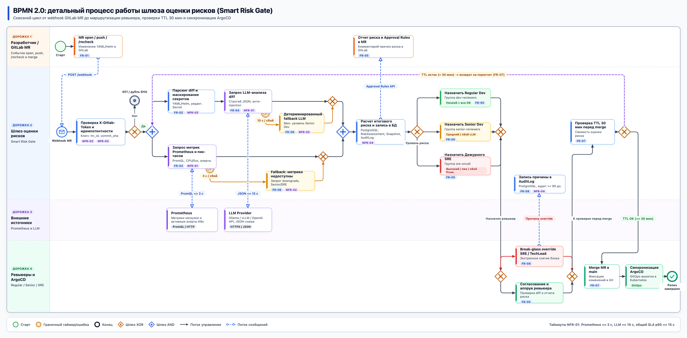
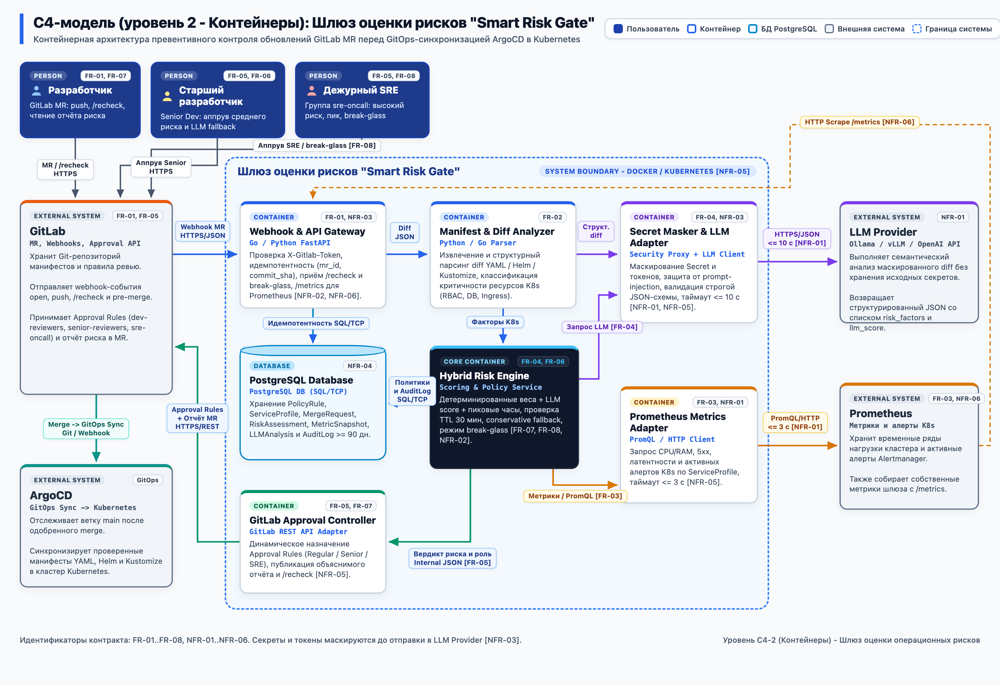
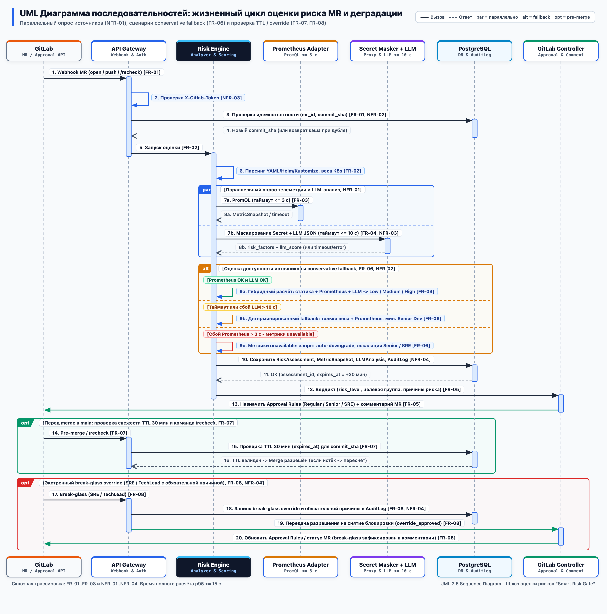
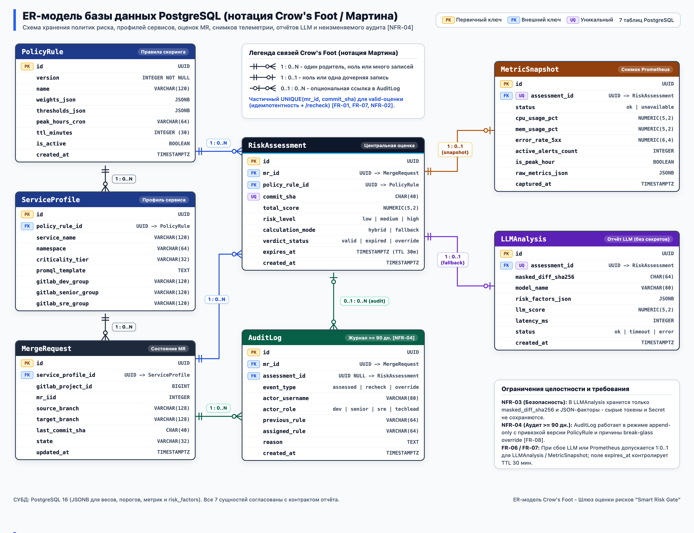
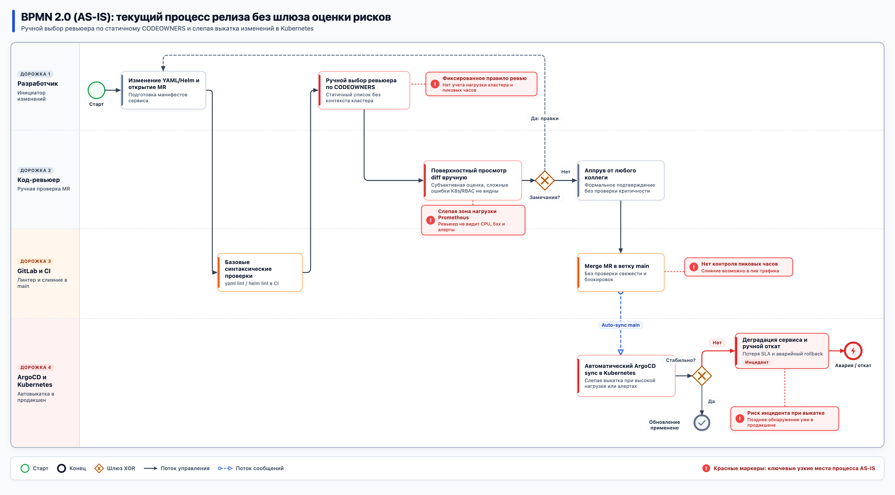
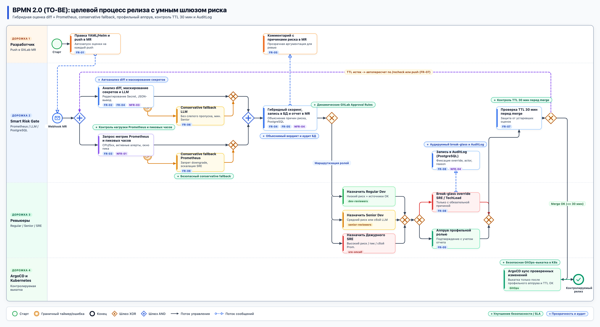

# ЛР 3 - проектирование

**Тема ВКР:** Проектирование и разработка сервиса для контроля обновлений в облачной инфраструктуре на основе оценки операционных рисков

**Автор:** Гордеев Артём Александрович

## 1. Предметная область и требования

### Описание предметной области

Предметная область охватывает контроль изменений инфраструктурных и прикладных конфигураций в облачной платформе Kubernetes с доставкой по модели GitOps. Источником обновлений выступает репозиторий GitLab, а после слияния ветки контроллер ArgoCD автоматически синхронизирует целевое состояние кластера. Стандартный процесс слияния Merge Request опирается на статические правила ревью и синтаксические линтеры, из-за чего не учитывает ни смысловую критичность правок в манифестах, ни текущую нагрузку сервисов в кластере.

Проектируемый сервис - шлюз оценки рисков "Smart Risk Gate" - встраивается в процесс обработки GitLab Merge Request до синхронизации ArgoCD. Сервис принимает webhook о событиях MR, разбирает структуру diff манифестов в форматах YAML, Helm и Kustomize, опрашивает Prometheus о текущей нагрузке, доле ошибок `5xx`, задержках и активных алертах, проверяет расписание пиковых часов и после маскирования секретов передаёт обезличенный diff в LLM через локальный сервер Ollama, vLLM или совместимый с OpenAI API. На основе гибридной модели скоринга сервис публикует отчёт с обоснованием оценки в комментарии MR и динамически назначает обязательную группу ревьюеров в GitLab Approval Rules.

Основные пользователи и роли системы:

- **Разработчик** - открывает Merge Request с правками манифестов, получает отчёт о факторах риска и при необходимости запускает повторную проверку командой `/recheck`;
- **Старший разработчик, группа `senior-reviewers`** - согласует изменения среднего риска, а также проверяет MR при переходе шлюза в режим `deterministic fallback` после отказа LLM;
- **Дежурный SRE, группа `sre-oncall`** - согласует изменения высокого риска, правки критичных инфраструктурных ресурсов, выкатки в пиковые часы и релизы при сбое Prometheus, а также применяет экстренное переопределение `break-glass override` совместно с ролью TechLead;
- **Контроллер ArgoCD и кластер Kubernetes** - синхронизируют целевое состояние кластера только после согласования MR назначенной группой и проверки актуальности оценки перед `merge`.

Ключевые процессы сервиса: идемпотентный приём webhook и пересчёт риска при каждом `push`, параллельный опрос Prometheus и LLM-анализ с жёсткими таймаутами, переключение в консервативный `deterministic fallback` при недоступности внешних источников, проверка срока действия оценки с TTL 30 минут перед `merge` и неизменяемый аудит решений в PostgreSQL.

### Функциональные требования

| ID | Требование | Как проверить выполнение |
|---|---|---|
| FR-01 | Приём webhook GitLab MR для событий `open`, `push` и комментария `/recheck` с проверкой идемпотентности по паре `mr_id` и `commit_sha`. | Повторная отправка webhook с теми же `mr_id` и `commit_sha` возвращает статус идемпотентного пропуска без повторного вызова LLM и без дублирования записи `RiskAssessment`; новый `commit_sha` или `/recheck` запускает новый цикл расчёта. |
| FR-02 | Извлечение и структурный парсинг diff манифестов в форматах YAML, Helm и Kustomize с классификацией критичности ресурсов Kubernetes. | Тестовый прогон MR с изменениями Deployment, Ingress, NetworkPolicy, RBAC, ConfigMap и Secret подтверждает корректное выделение вида ресурса, изменённых полей и базового веса критичности по правилам `PolicyRule`. |
| FR-03 | Запрос метрик нагрузки и активных алертов из Prometheus по шаблону `ServiceProfile` и учёт расписания пиковых часов. | Интеграционный тест с Prometheus HTTP API проверяет выполнение запроса по `promql_template`, сохранение `cpu_usage_pct`, `mem_usage_pct`, `error_rate_5xx`, `active_alerts_count` и расчёт флага `is_peak_hour` по `peak_hours_cron`. |
| FR-04 | Маскирование секретов и токенов в diff до передачи во внешние модули и гибридный расчёт риска на основе детерминированных весов и LLM-анализа в строгом формате JSON. | Юнит-тесты фиксируют замену значений `Secret`, паролей и ключей на маркер `[REDACTED]`, расчёт `masked_diff_sha256`, валидацию ответа LLM по JSON Schema и воспроизводимость `total_score` по правилам `PolicyRule`. |
| FR-05 | Динамическое назначение GitLab MR Approval Rules для групп `dev-reviewers`, `senior-reviewers`, `sre-oncall` и публикация отчёта с обоснованием оценки в комментарии MR. | В GitLab API обновляются правила согласования MR по вычисленному `risk_level`, а в ленте MR появляется комментарий с баллом риска, режимом расчёта, снимком метрик, факторами LLM и требуемой группой. |
| FR-06 | Переключение в режим `deterministic fallback` при отказе или таймауте LLM либо Prometheus. | При отключении LLM оценка формируется детерминированно с запретом назначения `dev-reviewers` и минимальной ролью `senior-reviewers`; при отказе Prometheus метрики помечаются `unavailable`, блокируется `auto-downgrade` и запрос эскалируется на `Senior Dev` или `Дежурного SRE`. |
| FR-07 | Контроль актуальности оценки перед `merge` с проверкой TTL 30 минут, поддержкой команды `/recheck` и автоматическим пересчётом при новом `push`. | Через 30 минут после `created_at` или при новом коммите проверка перед `merge` блокирует слияние с требованием выполнить `/recheck`; после пересчёта поле `expires_at` сдвигается на 30 минут вперёд. |
| FR-08 | Экстренное переопределение `break-glass override` для ролей SRE и TechLead с обязательным текстовым обоснованием и аудитом в PostgreSQL. | Запрос override от пользователя без роли SRE/TechLead либо с пустой причиной отклоняется; успешное переопределение фиксируется в `AuditLog` с полями `actor_username`, `actor_role`, `previous_rule`, `assigned_rule` и `reason`. |

### Нефункциональные требования

| ID | Требование | Как проверить выполнение |
|---|---|---|
| NFR-01 | 95-й процентиль времени полного расчёта операционного риска не более 15 с при таймауте Prometheus не более 3 с и таймауте LLM не более 10 с. | Нагрузочный тест из 100 последовательных и параллельных MR фиксирует `p95 <= 15 с`; при искусственной задержке мок-сервисов клиентские вызовы Prometheus и LLM принудительно обрываются через 3 с и 10 с. |
| NFR-02 | Идемпотентность обработки событий по паре `mr_id` и `commit_sha` и безотказная деградация по схеме `conservative fallback`. | Тест с дублирующимися webhook и имитацией отказов Prometheus и LLM подтверждает отсутствие повторных оценок для одного `commit_sha` и штатное завершение проверки MR без бесконтрольного допуска к слиянию. |
| NFR-03 | Безопасность обработки данных: проверка заголовка `X-Gitlab-Token`, маскирование секретов до передачи в LLM, защита от prompt-injection и запрет на хранение открытых токенов и секретов. | Негативные тесты проверяют HTTP 401/403 при неверном `X-Gitlab-Token`, нейтрализацию управляющих инструкций в diff и отсутствие открытых токенов в таблицах `LLMAnalysis`, `AuditLog` и журналах сервиса. |
| NFR-04 | Неизменяемый аудит решений в PostgreSQL со сроком хранения не менее 90 дней, включающий снимки метрик, хеш diff, JSON LLM, версию `PolicyRule` и решения `override`. | Проверка DDL-схемы и политики хранения подтверждает append-only запись в `AuditLog`, сохранение `masked_diff_sha256`, `raw_metrics_json`, `risk_factors_json`, `policy_rule_id` и хранение партиций не менее 90 дней. |
| NFR-05 | Модульная архитектура с изолированными адаптерами для GitLab, Prometheus и LLM и полная контейнеризация для запуска в Docker и Kubernetes. | Переключение провайдера LLM между Ollama, vLLM и OpenAI API задаётся в конфигурации без правки ядра `Hybrid Risk Engine`; сервис собирается в OCI-контейнер и разворачивается в кластере `kind` или `k3s`. |
| NFR-06 | Наблюдаемость сервиса через эндпоинт `/metrics` для Prometheus и структурированные JSON-логи со сквозным идентификатором `correlation_id`. | Запрос `GET /metrics` отдаёт счётчики оценок, гистограмму задержек и метрики срабатывания fallback; поиск по `correlation_id` в JSON-логах связывает приём webhook, внешние запросы и вызов GitLab API. |

## 2. Обзор нотаций и видов диаграмм

| Нотация или вид диаграммы | Что описывает | Сильные стороны |
|---|---|---|
| BPMN 2.0 | Бизнес-процессы и межсервисные взаимодействия через пулы, дорожки, события, задачи и логические шлюзы. | Чётко разграничивает ответственность участников, поддерживает граничные события таймера и ошибок, подходит для наглядного сравнения процессов AS-IS и TO-BE. |
| C4 Model - Context и Container | Архитектуру системы на уровне внешнего окружения, исполняемых контейнеров, хранилищ и протоколов связи. | Явно выделяет границы системы и доверенные контуры, показывает технологический стек каждого контейнера без лишних деталей реализации. |
| UML Sequence Diagram | Временную последовательность обмена сообщениями между компонентами и внешними сервисами, включая блоки `par`, `alt` и `opt`. | Точно фиксирует синхронность и параллельность вызовов, таймауты, ветки деградации и порядок записи транзакций в базу данных. |
| ER-диаграмма в нотации Crow's Foot | Реляционную схему базы данных с таблицами, типами полей, первичными и внешними ключами, а также кардинальностью связей. | Однозначно описывает структуру хранения и ссылочную целостность перед написанием SQL-миграций PostgreSQL. |
| UML Activity Diagram | Алгоритмы вычислений, ветвления условий и циклы внутри отдельного программного модуля. | Компактна для детализации локального алгоритма скоринга, однако слабее BPMN 2.0 при описании межсистемных границ и обработке таймаутов. |
| UML Component Diagram | Внутренние программные пакеты, интерфейсы, порты и зависимости между модулями кода. | Полезна для проектирования контрактов адаптеров в коде, но хуже отражает архитектуру развёртывания, чем C4 Container. |
| UML State Machine Diagram | Жизненный цикл объекта через состояния, переходы, триггеры и сторожевые условия. | Хорошо описывает переходы статусов Merge Request, но не отражает схему базы данных, таймауты внешних API и распределение ролей. |
| DFD - Data Flow Diagram | Движение, преобразование и хранение потоков данных между внешними сущностями, процессами и накопителями. | Выделяет точки трансформации и маскирования конфиденциальных данных, но не передаёт хронологию вызовов и логику отказоустойчивости. |
| IDEF0 | Иерархическую функциональную декомпозицию с разделением входов, выходов, механизмов и управляющих правил. | Подходит для регламентной документации верхнего уровня, однако неудобна для моделирования асинхронных событий и fallback-переключений. |
| UML Deployment Diagram | Физическую и облачную топологию узлов, подов Kubernetes, контейнеров и сетевых маршрутов. | Фиксирует схему развёртывания в кластере и изоляцию контуров, но не раскрывает бизнес-процессы и модель данных. |
| EPC - Event-driven Process Chain | Цепочки организационных процессов в связке событий, функций и логических операторов. | Проста для описания административных регламентов, но уступает стандарту BPMN 2.0 в описании граничных исключений и таймеров. |
| ArchiMate | Комплексную архитектуру предприятия от бизнес-слоя до технологической инфраструктуры. | Обеспечивает сквозную трассируемость корпоративного ландшафта, но избыточна для проектирования отдельного прикладного сервиса. |

## 3. Выбор нотаций для проекта

Для проектирования шлюза контроля обновлений выбраны четыре взаимодополняющие нотации, охватывающие процессную логику, контейнерную архитектуру, хронологию вызовов с таймаутами и реляционную модель данных.

| Нотация или вид диаграммы | Что моделируем | Связанные требования | Почему подходит |
|---|---|---|---|
| BPMN 2.0 | Сквозной процесс оценки риска MR в разделе 4 и сравнение процессов AS-IS и TO-BE в разделе 5. | FR-01, FR-02, FR-03, FR-04, FR-05, FR-06, FR-07, FR-08, NFR-01, NFR-02, NFR-03, NFR-04 | Дорожки разделяют действия разработчика, шлюза Smart Risk Gate, внешних источников, ревьюеров и ArgoCD; шлюзы `AND` и `XOR` с граничными событиями таймера на 3 с и 10 с явно задают ветку `deterministic fallback`, проверку TTL 30 мин и `break-glass override`. |
| C4 Model - Container | Контейнерную архитектуру шлюза "Smart Risk Gate", внутренние компоненты, БД PostgreSQL и внешние интеграции. | FR-01, FR-02, FR-03, FR-04, FR-05, FR-06, FR-07, FR-08, NFR-01, NFR-02, NFR-03, NFR-04, NFR-05, NFR-06 | Показывает модульное разбиение на изолированные адаптеры GitLab, Prometheus и LLM, узел маскирования секретов перед отправкой в LLM, эндпоинт `/metrics` и контейнерную компоновку. |
| UML Sequence Diagram | Сценарий обработки webhook, параллельный опрос источников, деградацию, сохранение в БД и проверку TTL перед `merge`. | FR-01, FR-02, FR-03, FR-04, FR-05, FR-06, FR-07, FR-08, NFR-01, NFR-02, NFR-03, NFR-04 | Однозначно фиксирует порядок аутентификации и проверки идемпотентности до вычислений, блок `par` для соблюдения ограничения p95 <= 15 с, три ветки в `alt` для консервативного fallback и блок `opt` для контроля TTL 30 мин и `break-glass override`. |
| ER-модель Crow's Foot | Физическую схему базы данных PostgreSQL из семи таблиц для политик, профилей, оценок, снимков метрик, отчётов LLM и аудита. | FR-01, FR-03, FR-04, FR-05, FR-06, FR-07, FR-08, NFR-02, NFR-03, NFR-04 | Точно определяет ключи, типы данных и связи `1:0..N`, `1:0..1` и `0..1:0..N`, обеспечивая идемпотентность через `UNIQUE(mr_id, commit_sha)`, хранение хеша SHA-256 вместо открытых секретов и неизменяемый аудит сроком не менее 90 дней. |

## 4. Модели системы

### Детальная модель процесса оценки рисков в нотации BPMN 2.0

**Диаграмма:**

Рисунок 1 - Детальная модель процесса работы шлюза оценки рисков в нотации BPMN 2.0

**Пояснение модели:**

Диаграмма разделена на четыре дорожки: `Разработчик / GitLab MR`; `Шлюз оценки рисков` - `Smart Risk Gate`; `Внешние источники` - `Prometheus и LLM`; `Ревьюеры и ArgoCD` - `Regular / Senior / SRE`. Процесс запускается стартовым событием `MR open / push / /recheck`, после чего поток сообщений `POST /webhook` поступает в шлюз. Задача `Проверка X-Gitlab-Token и идемпотентности` валидирует заголовок и ключ `mr_id, commit_sha`: при ошибке токена или дубле процесс завершается на конечном событии `401 / дубль SHA`.

При новом коммите параллельный шлюз `AND` запускает две ветки: разбор diff с маскированием секретов и запросом к `LLM Provider`, а также опрос `Prometheus` с проверкой пиковых часов. Граничные события таймера и ошибки `10 с / сбой` и `3 с / сбой` переводят процесс в задачи `Детерминированный fallback LLM` и `Fallback: метрики недоступны`. После объединяющего шлюза `AND` задача `Расчёт итогового риска и запись в БД` сохраняет `RiskAssessment`, `Snapshot` и `AuditLog`, отправляет комментарий в MR и передаёт управление шлюзу `XOR` выбора роли. Контур согласования включает задачу `Согласование и аппрув ревьюера` и ветку `Break-glass override SRE / TechLead` с обязательной записью причины в `AuditLog`. Перед слиянием проходит `Проверка TTL 30 мин перед merge`: при истечении срока поток возвращается на пересчёт, а при `TTL OK <= 30 мин` запускаются `Merge MR в main` и `Синхронизация ArgoCD`.

**Отражённые функциональные требования и элементы модели:**

- `FR-01` - стартовое событие `MR open / push / /recheck`, событие `Webhook MR` и задача проверки `X-Gitlab-Token` и идемпотентности по паре `mr_id` и `commit_sha`;
- `FR-02` и `FR-04` - задачи `Парсинг diff и маскирование секретов` и `Запрос LLM-анализа diff` с передачей очищенного diff во внешний `LLM Provider` по `HTTPS / JSON`;
- `FR-03` - задача `Запрос метрик Prometheus и пик-часов` с обращением к `Prometheus` по `PromQL / HTTP`;
- `FR-06` - граничные события `10 с / сбой` и `3 с / сбой`, ведущие в `Детерминированный fallback LLM` с минимумом `Senior Dev` и в `Fallback: метрики недоступны` с запретом `auto-downgrade`;
- `FR-05` - публикация блока `Отчёт риска и Approval Rules в MR` и шлюз `XOR` выбора уровня между `Назначить Regular Dev`, `Назначить Senior Dev` и `Назначить Дежурного SRE`;
- `FR-07` - задача `Проверка TTL 30 мин перед merge` с циклом возврата при просрочке и переходом к `Merge MR в main`;
- `FR-08` - альтернативная задача `Break-glass override SRE / TechLead` с потоком сообщений `Причина override` в задачу `Запись причины в AuditLog`.

**Нефункциональные требования и проектные решения:**

- `NFR-01` - распараллеливание через шлюз `AND` и таймеры `PromQL <= 3 с` и `JSON <= 10 с` удерживают общую задержку на уровне `p95 <= 15 с`;
- `NFR-02` - ранняя отсечка дублей по `commit_sha` и граничные ветки деградации гарантируют предсказуемый ответ без пропуска непроверенных изменений;
- `NFR-03` - валидация `X-Gitlab-Token` и маскирование `Secret` выполняются до отправки запросов во внешнюю дорожку;
- `NFR-04` - задачи записи в PostgreSQL фиксируют снимки, решения и причины `override` со сроком хранения не менее 90 дней.

### Контейнерная архитектура системы в нотации C4 Container

**Диаграмма:**

Рисунок 2 - Контейнерная архитектура шлюза Smart Risk Gate в нотации C4

**Пояснение модели:**

Диаграмма второго уровня модели C4 определяет границы системы `Шлюз оценки рисков "Smart Risk Gate"`, три роли пользователей: `Разработчик`, `Старший разработчик`, `Дежурный SRE`, а также четыре внешние системы: `GitLab`, `LLM Provider`, `Prometheus` и `ArgoCD`. Внутри системы размещены семь контейнеров: `Webhook & API Gateway` на стеке `Go / Python FastAPI`; `Manifest & Diff Analyzer` на базе `Python / Go Parser`; `Secret Masker & LLM Adapter` в роли `Security Proxy + LLM Client`; `Prometheus Metrics Adapter` как `PromQL / HTTP Client`; центральное ядро `Hybrid Risk Engine`, реализующее `Scoring & Policy Service`; `GitLab Approval Controller` как `GitLab REST API Adapter`; хранилище `PostgreSQL Database`. Потоки данных между периметром и ядром передаются по протоколам и форматам `HTTPS/JSON`, `PromQL/HTTP`, `HTTPS/REST`, `Internal JSON`, `SQL/TCP` и `HTTP Scrape /metrics`.

**Отражённые функциональные требования и элементы модели:**

- `FR-01` - `Webhook & API Gateway` принимает от `GitLab` вызов `Webhook MR HTTPS/JSON` и проверяет идемпотентность по `SQL/TCP` в `PostgreSQL Database`;
- `FR-02` - `Manifest & Diff Analyzer` получает `Diff JSON`, разбирает YAML, Helm и Kustomize и передаёт в ядро `Факторы K8s`;
- `FR-03` - `Hybrid Risk Engine` запрашивает состояние сервисов по потоку `Метрики / PromQL`, а `Prometheus Metrics Adapter` выполняет запросы `PromQL/HTTP <= 3 с` к внешнему `Prometheus` по шаблонам `ServiceProfile`;
- `FR-04` - `Secret Masker & LLM Adapter` получает распарсенный `Структ. diff` от `Manifest & Diff Analyzer` и сигнал `Запрос LLM` от `Hybrid Risk Engine`, маскирует секреты и обращается к `LLM Provider` по `HTTPS/JSON <= 10 с`, после чего ядро рассчитывает итоговый риск;
- `FR-05` - `GitLab Approval Controller` получает от ядра `Вердикт риска и роль Internal JSON` и отправляет в `GitLab` запрос `Approval Rules + Отчёт MR HTTPS/REST`;
- `FR-06`, `FR-07`, `FR-08` - правила `conservative fallback`, контроля TTL 30 мин и обработки `break-glass override` выполняет `Hybrid Risk Engine`, сохраняя состояние в `PostgreSQL Database`.

**Нефункциональные требования и проектные решения:**

- `NFR-01` - ограничения времени ответа `<= 3 с` и `<= 10 с` заданы в сетевых клиентах двух внешних адаптеров;
- `NFR-03` - проверка `X-Gitlab-Token` на шлюзе и контур `Security Proxy + LLM Client` предотвращают несанкционированный запуск, утечку `Secret` и атаки prompt-injection;
- `NFR-04` - `PostgreSQL Database` хранит таблицы `PolicyRule`, `ServiceProfile`, `MergeRequest`, `RiskAssessment`, `MetricSnapshot`, `LLMAnalysis` и `AuditLog` со сроком хранения не менее 90 дней;
- `NFR-05` - изолированные адаптеры позволяют заменять провайдеров Ollama, vLLM и OpenAI API без правки ядра, а система подготовлена к запуску в Docker и Kubernetes;
- `NFR-06` - внешний `Prometheus` снимает собственные метрики шлюза через `HTTP Scrape /metrics`, а все контейнеры пишут JSON-логи с `correlation_id`.

### Сценарий взаимодействия и деградации в нотации UML Sequence

**Диаграмма:**

Рисунок 3 - Диаграмма взаимодействия компонентов и деградации в нотации UML Sequence

**Пояснение модели:**

Диаграмма последовательностей включает семь линий жизни: `GitLab`, `API Gateway`, `Risk Engine`, `Prometheus Adapter`, `Secret Masker + LLM`, `PostgreSQL` и `GitLab Controller`. Сообщения 1-20 описывают полный цикл обработки события MR. На шагах 1-5 шлюз принимает webhook, валидирует `X-Gitlab-Token`, сверяет `mr_id` и `commit_sha` в `PostgreSQL` и передаёт управление в `Risk Engine`. На шаге 6 выполняется парсинг манифестов, затем во фрагменте `par` на шагах 7a-8b параллельно запускаются сбор метрик Prometheus и LLM-анализ маскированного diff. Фрагмент `alt` на шагах 9a-9c задаёт три режима расчёта в зависимости от доступности источников. На шагах 10-13 результат атомарно записывается в БД с фиксацией `expires_at = +30 мин` и передаётся в `GitLab Controller`. В завершающей части два фрагмента `opt` моделируют проверку TTL перед `merge` на шагах 14-16 и экстренный `break-glass override` на шагах 17-20.

**Отражённые функциональные требования и элементы модели:**

- `FR-01` - сообщения 1-4: приём `Webhook MR`, проверка в `PostgreSQL` по `mr_id` и `commit_sha` с возвратом кэша при дубле или запуском расчёта для нового `commit_sha`;
- `FR-02` - сообщения 5-6: запуск оценки и структурный парсинг YAML/Helm/Kustomize с расчётом весов ресурсов K8s;
- `FR-03` и `FR-04` - блок `par`, сообщения 7a-8b: запрос `PromQL` с получением `MetricSnapshot` и маскирование секретов с получением `risk_factors` и `llm_score`;
- `FR-06` - блок `alt`, сообщения 9a-9c: штатный гибридный расчёт `Low / Medium / High`, ветка таймаута LLM с переходом на детерминированные веса и метрики Prometheus при минимальной роли `Senior Dev`, ветка сбоя Prometheus со статусом `unavailable`, запретом `auto-downgrade` и эскалацией на `Senior / SRE`;
- `FR-05` - сообщения 12-13: передача вердикта в `GitLab Controller`, назначение `Approval Rules` для `Regular / Senior / SRE` и публикация комментария MR;
- `FR-07` - первый блок `opt`, сообщения 14-16: запрос `Pre-merge / /recheck`, проверка `expires_at` в `PostgreSQL` и разрешение слияния при действующем TTL 30 мин или запуск пересчёта при истечении срока;
- `FR-08` - второй блок `opt`, сообщения 17-20: запрос `Break-glass` от `SRE / TechLead`, запись события и обязательной причины в `AuditLog`, передача `override_approved` в `GitLab Controller` и обновление статуса и комментария в GitLab MR.

**Нефункциональные требования и проектные решения:**

- `NFR-01` - параллельное выполнение в блоке `par` с таймаутами `<= 3 с` на шаг 7a и `<= 10 с` на шаг 7b ограничивает суммарную задержку p95 пределом 15 с;
- `NFR-02` - явные ветки `alt` и проверка дублей на шаге 3 задают однозначное поведение при сбоях;
- `NFR-03` - шаг 2 `Проверка X-Gitlab-Token` выполняется до вызова `Risk Engine`, а маскирование `Secret` завершается внутри `Secret Masker + LLM` до обращения к внешнему API;
- `NFR-04` - шаг 10 сохраняет `RiskAssessment`, `MetricSnapshot`, `LLMAnalysis` и `AuditLog` в одной транзакции до выдачи вердикта в GitLab.

### Модель базы данных PostgreSQL в нотации ER Crow's Foot

**Диаграмма:**

Рисунок 4 - ER-модель базы данных PostgreSQL в нотации Crow's Foot

**Пояснение модели:**

Физическая схема базы данных PostgreSQL в нотации Crow's Foot содержит семь таблиц: `PolicyRule`, `ServiceProfile`, `MergeRequest`, `RiskAssessment`, `MetricSnapshot`, `LLMAnalysis` и `AuditLog`. Центральная таблица `RiskAssessment` связывает каждый расчёт с состоянием `MergeRequest`, версией политики `PolicyRule`, снимком телеметрии `MetricSnapshot`, результатом анализа `LLMAnalysis` и журналом событий `AuditLog`. В схеме используются типы PostgreSQL `UUID`, `JSONB`, `TIMESTAMPTZ`, `CHAR(40)`, `CHAR(64)`, `NUMERIC(5,2)` и `NUMERIC(6,4)`.

Кардинальность связей между сущностями:

- `PolicyRule` к `ServiceProfile` - `1:0..N` по внешнему ключу `policy_rule_id`;
- `PolicyRule` к `RiskAssessment` - `1:0..N` по внешнему ключу `policy_rule_id` для фиксации действовавшей версии правил;
- `ServiceProfile` к `MergeRequest` - `1:0..N` по внешнему ключу `service_profile_id`;
- `MergeRequest` к `RiskAssessment` - `1:0..N` по внешнему ключу `mr_id`;
- `MergeRequest` к `AuditLog` - `1:0..N` по внешнему ключу `mr_id`;
- `RiskAssessment` к `MetricSnapshot` - `1:0..1` по уникальному внешнему ключу `assessment_id`;
- `RiskAssessment` к `LLMAnalysis` - `1:0..1` по уникальному внешнему ключу `assessment_id`;
- `RiskAssessment` к `AuditLog` - `0..1:0..N`, так как поле `assessment_id` в `AuditLog` допускает `NULL` для событий уровня MR.

**Отражённые функциональные требования и элементы модели:**

- `FR-01` и `FR-07` - поля `last_commit_sha` в `MergeRequest`, `commit_sha`, `verdict_status` со значениями `valid | expired | override`, `expires_at` и `created_at` в `RiskAssessment`, а также `ttl_minutes` в `PolicyRule`;
- `FR-03` - атрибуты `promql_template` в `ServiceProfile`, `peak_hours_cron` в `PolicyRule` и поля `status` со значениями `ok | unavailable`, `cpu_usage_pct`, `mem_usage_pct`, `error_rate_5xx`, `active_alerts_count`, `is_peak_hour`, `raw_metrics_json` в `MetricSnapshot`;
- `FR-04` - поля `weights_json` и `thresholds_json` в `PolicyRule`, `model_name`, `risk_factors_json`, `llm_score`, `latency_ms` в `LLMAnalysis` и `total_score`, `risk_level` со значениями `low | medium | high` в `RiskAssessment`;
- `FR-05` - поля `gitlab_dev_group`, `gitlab_senior_group`, `gitlab_sre_group` в `ServiceProfile` и `assigned_rule` в `AuditLog`;
- `FR-06` - атрибут `calculation_mode` со значениями `hybrid | fallback` в `RiskAssessment` и поле `status` со значениями `ok | timeout | error` в `LLMAnalysis`;
- `FR-08` - таблица `AuditLog` с полями `event_type` со значениями `assessed | recheck | override`, `actor_username`, `actor_role` со значениями `dev | senior | sre | techlead`, `previous_rule`, `assigned_rule` и `reason`.

**Нефункциональные требования и проектные решения:**

- `NFR-02` - частичный уникальный индекс `UNIQUE(mr_id, commit_sha)` для текущей оценки со статусом `verdict_status = 'valid'` в `RiskAssessment` гарантирует идемпотентность при дублях webhook, не блокируя принудительный пересчёт по `/recheck` после истечения или сброса предыдущей версии;
- `NFR-03` - в `LLMAnalysis` сохраняются только хеш `masked_diff_sha256` типа `CHAR(64)` и JSON факторов риска без исходных секретов и токенов;
- `NFR-04` - таблица `AuditLog` работает в режиме append-only с внешними ключами на `MergeRequest` и `RiskAssessment` и хранением данных не менее 90 дней.

## 5. AS-IS и TO-BE

**Выбранная нотация:** BPMN 2.0

### AS-IS - текущее состояние

**Диаграмма:**

Рисунок 5 - Процесс релиза AS-IS без шлюза оценки рисков

**Описание и ограничения:**

Модель AS-IS включает четыре дорожки: `Разработчик`, `Код-ревьюер`, `GitLab и CI`, а также `ArgoCD и Kubernetes`. После задачи `Изменение YAML/Helm и открытие MR` пайплайн выполняет только `Базовые синтаксические проверки` - `yaml lint / helm lint в CI`. Далее следует `Ручной выбор ревьюера по CODEOWNERS`, после которого выполняются `Поверхностный просмотр diff вручную` с циклом доработок при замечаниях и формальный `Аппрув от любого коллеги`. После `Merge MR в ветку main` контроллер запускает `Автоматический ArgoCD sync в Kubernetes`, что без проверки состояния кластера ведёт к сценарию `Деградация сервиса и ручной откат`.

На диаграмме красными маркерами выделены четыре узких места:

1. **Фиксированное правило ревью** - выбор ревьюера по `CODEOWNERS` не учитывает семантическую критичность правок в манифестах и контекст кластера;
2. **Слепая зона нагрузки Prometheus** - ревьюер не видит текущую загрузку CPU, долю ошибок `5xx` и активные алерты сервиса;
3. **Нет контроля пиковых часов** - слияние MR в `main` не ограничено в периоды пиковой нагрузки;
4. **Риск инцидента при выкатке** - проблемы выявляются уже в продакшене после автоматической синхронизации ArgoCD и требуют аварийного отката.

### TO-BE - предлагаемое состояние

**Диаграмма:**

Рисунок 6 - Целевой процесс релиза TO-BE со шлюзом оценки рисков

**Описание изменений:**

Модель TO-BE включает четыре дорожки: `Разработчик`; `Smart Risk Gate` с контуром `Prometheus / LLM / PostgreSQL`; `Ревьюеры` - `Regular / Senior / SRE`; `ArgoCD и Kubernetes`. При каждом `push` параллельно запускаются задачи `Анализ diff, маскирование секретов и LLM` и `Запрос метрик Prometheus и пиковых часов`. При сбое или таймауте источников активируются ветки `Conservative fallback LLM` и `Conservative fallback Prometheus`. Далее `Гибридный скоринг, запись в БД и отчёт в MR` публикует `Комментарий с причинами риска в MR`, а шлюз маршрутизации назначает `Regular Dev`, `Senior Dev` или `Дежурного SRE`. На дорожке ревьюеров действует `Аппрув профильной ролью` либо исключительный `Break-glass override SRE / TechLead` с обязательным переходом к задаче `Запись в AuditLog`. Перед выкаткой проходит `Проверка TTL 30 мин перед merge`, и только при `Merge OK <= 30 мин` запускается `ArgoCD sync проверенных изменений`.

### Обоснование перехода

Зелёные и синие маркеры улучшений на схеме TO-BE устраняют каждое узкое место процесса AS-IS:

| Узкое место AS-IS | Решение в TO-BE и маркер на схеме | Отражённые требования |
|---|---|---|
| Фиксированное правило ревью | `+ Автоанализ diff и маскирование секретов` и `+ Динамические GitLab Approval Rules` распределяют MR между `dev-reviewers`, `senior-reviewers` и `sre-oncall`. | FR-02, FR-04, FR-05, NFR-03 |
| Слепая зона нагрузки Prometheus | `+ Контроль нагрузки Prometheus и пиковых часов` и `+ Безопасный conservative fallback` исключают пропуск правок без учёта CPU, `5xx` и алертов. | FR-03, FR-06, NFR-01, NFR-02 |
| Нет контроля пиковых часов | `+ Контроль нагрузки Prometheus и пиковых часов` повышает уровень эскалации в пиковые часы, а `+ Контроль TTL 30 мин перед merge` возвращает устаревшие MR на пересчёт через `/recheck` или новый `push`. | FR-01, FR-03, FR-07 |
| Риск инцидента при выкатке | `+ Объяснимый вердикт и аудит БД`, `+ Аудируемый break-glass и AuditLog` и `+ Безопасная GitOps-выкатка в K8s` допускают к синхронизации ArgoCD только проверенные изменения. | FR-05, FR-06, FR-08, NFR-04, NFR-06 |

Переход от AS-IS к TO-BE убирает зависимость безопасного релиза от субъективного ручного просмотра diff и разгружает дежурных SRE: низкорисковые правки при штатном состоянии кластера уходят группе `dev-reviewers`, а старшие инженеры разбирают рискованные изменения.

## 6. Выводы

1. **Пригодность выбранных нотаций для темы ВКР.** Выбранный набор из BPMN 2.0, C4 Container, UML Sequence и ER-модели в нотации Crow's Foot описывает процессы, архитектуру, взаимодействия и структуру данных сервиса контроля обновлений. BPMN 2.0 формализует сквозной процесс и сравнение AS-IS с TO-BE, C4 Container определяет границы и стек модулей, UML Sequence задаёт параллельное выполнение с таймаутами и деградацией, а ER-модель фиксирует схему долгосрочного аудита в PostgreSQL.
2. **Отражение требований в моделях.** Все требования от `FR-01` до `FR-08` и от `NFR-01` до `NFR-06` отражены на диаграммах: от валидации `X-Gitlab-Token` и таймаутов 3 с и 10 с при параллельных запросах до трёх веток деградации в блоке `alt`, проверки TTL 30 минут в блоке `opt` и семи таблиц базы данных.
3. **Согласованность процессов, данных и взаимодействий.** Все четыре модели используют единый набор сущностей и интерфейсов: дорожки BPMN 2.0 сопоставлены с контейнерами C4 и линиями жизни UML Sequence, а операции сохранения состояния в сценарии UML Sequence работают с таблицами `PolicyRule`, `ServiceProfile`, `MergeRequest`, `RiskAssessment`, `MetricSnapshot`, `LLMAnalysis` и `AuditLog` из ER-модели.
4. **Ключевые улучшения TO-BE относительно AS-IS.** Целевой процесс заменяет формальный синтаксический контроль и статический `CODEOWNERS` на гибридную оценку риска до слияния в `main`, вводит консервативный fallback при сбоях LLM или Prometheus, ограничивает срок действия оценки тридцатью минутами и фиксирует каждое решение в неизменяемом журнале аудита перед синхронизацией ArgoCD.
