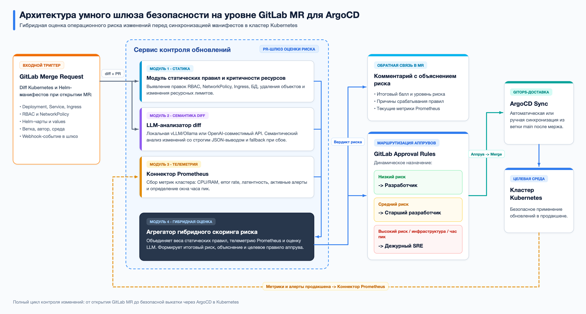
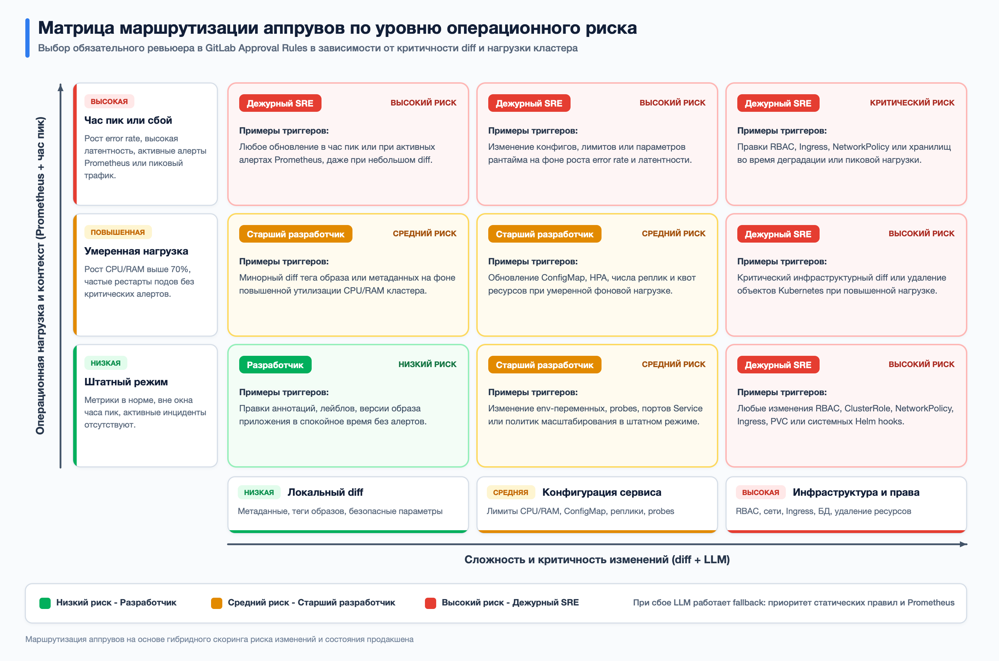

# ЛР 2 - обоснование актуальности ВКР

**Тема ВКР:** Проектирование и разработка сервиса для контроля обновлений в облачной инфраструктуре на основе оценки операционных рисков

**Автор:** Гордеев Артём Александрович

## 1. Кто занимается темой

### Исследователи и разработчики

| Имя | Связь с темой, работы или проекты | Ссылка |
|---|---|---|
| Qingwei Lin и Yingnong Dang | Исследователи Microsoft Research в области Cloud Intelligence и AIOps. Развивают методы проактивной оценки рисков изменений и деплоя в облаке, соавторы работы "AIOps: Real-World Challenges and Research Innovations", 2019 | [Microsoft Research](https://www.microsoft.com/en-us/research/people/qlin/) |
| Asaf Shabtai | Профессор Ben-Gurion University of the Negev. Руководит исследованиями по LLM-проверке, локализации ошибок и усилению безопасности манифестов Kubernetes с учетом runtime-логов: работы "GenKubeSec", 2024 и "KubeGuard", 2025 | [Ben-Gurion University](https://cris.bgu.ac.il/en/persons/asaf-shabtai) |
| Alexander Matyushentsev и Jesse Suen | Соавторы экосистемы Argo в Intuit и CNCF. Создатели архитектуры декларативной доставки Argo CD и прогрессивной выкатки Argo Rollouts с проверкой рисков по метрикам Prometheus | [Argo Project](https://github.com/argoproj) |
| Julius Volz | Сооснователь Prometheus, мейнтейнер CNCF и основатель PromLabs. Разработчик спецификаций PromQL и методик оценки состояния распределенных сервисов по временным рядам | [PromLabs](https://promlabs.com/blog/) |
| Дмитрий Юрьевич Турдаков | Заведующий отделом ИСП РАН. Ведет исследования в области обработки текста, больших языковых моделей и защиты LLM от состязательных атак в корпоративных системах | [Труды ИСП РАН](https://ispranproceedings.elpub.ru/jour/article/view/2033) |

### Организации

| Название | Работы или проекты по теме | Ссылка |
|---|---|---|
| Microsoft Research | Подразделения Cloud Intelligence и Software Analytics. Исследования в области AIOps, прогнозирования инцидентов при выкатке обновлений и открытый бенчмарк AIOpsLab | [arXiv:2501.06706](https://arxiv.org/abs/2501.06706) |
| Intuit и CNCF | Площадка развития проекта Argo Project. Стандартизация GitOps-доставки в Kubernetes через Argo CD и гейтинга релизов через Argo Rollouts с Prometheus | [ArgoProj](https://argoproj.github.io/) |
| Datadog | Разработчик платформы наблюдаемости и AIOps-движка Watchdog для выявления дефектных деплоев Kubernetes и мониторинга синхронизаций Argo CD | [Datadog Watchdog](https://www.datadoghq.com/blog/watchdog-faulty-kubernetes-deployment/) |
| ИСП РАН | Институт системного программирования им. В. П. Иванникова РАН. Работы по облачной оркестрации, статическому анализу и защите LLM в прикладных системах | [ИСП РАН](https://www.ispras.ru/) |
| VK Tech | Российская технологическая компания, развивающая практики Kubernetes, GitOps и локальных read-only ИИ-агентов для анализа кластера | [Блог VK Tech на Хабре](https://habr.com/ru/companies/vktech/articles/1054268/) |

### Конференции

| Название | Какие работы по теме представлены | Ссылка |
|---|---|---|
| KubeCon + CloudNativeCon | Главная конференция CNCF по Kubernetes, GitOps, Argo CD, Prometheus и LLM-инфраструктуре. Пример доклада 2025 года: "GitOps for AI Agents: Building Reliable AI Pipelines With Argo" | [Расписание KubeCon 2025](https://kccncna2025.sched.com/event/27FfB/gitops-for-ai-agents-building-reliable-ai-pipelines-with-argo-benji-kalman-rootio-shiran-melamed-jfrog) |
| USENIX SREcon | Ведущая инженерная конференция по надежности облачной инфраструктуры и рискам релизов. Пример доклада на SREcon26 Americas: Ganesh Vernekar, "Unlock High-Frequency Deployments without Blowing Up Prometheus" | [USENIX SREcon26](https://www.usenix.org/conference/srecon26americas/presentation/vernekar) |
| IEEE/ACM ICSE | Ключевая научная конференция по программной инженерии и AIOps. Пример работы: Dang Y., Lin Q., Huang P., "AIOps: Real-World Challenges and Research Innovations", 2019 | [IEEE Xplore / DOI](https://doi.org/10.1109/ICSE-Companion.2019.00023) |
| HighLoad++ | Крупнейшая российская конференция по высоконагруженным системам. Пример доклада: О. Вознесенский, "Что такое GitOps и почему он (почти) бесполезен", HighLoad++ Foundation, 2022 | [HighLoad++ Foundation 2022](https://highload.ru/foundation/2022/abstracts/7912) |

### Научные журналы

| Название | Какие работы по теме опубликованы | Ссылка |
|---|---|---|
| IEEE Transactions on Cloud Computing | Статьи по облачной инфраструктуре и прогнозированию нагрузки, например Kim Y.-M. et al., "Enhancing Long-Term Cloud Workload Forecasting Framework: Anomaly Handling and Ensemble Learning in Multivariate Time Series", т. 12, № 2, 2024 | [DOI 10.1109/TCC.2024.3400859](https://doi.org/10.1109/TCC.2024.3400859) |
| IEEE Software | Публикации по инженерным практикам DevOps и GitOps, например Beetz F., Harrer S., "GitOps: The Evolution of DevOps?", т. 39, 2022 | [DOI 10.1109/MS.2021.3119106](https://doi.org/10.1109/MS.2021.3119106) |
| Труды ИСП РАН | Статьи по системному программированию и безопасности ИИ, например Алексеевская И. С., Хайбуллин Д. В., Турдаков Д. Ю., "Разработка защиты больших языковых моделей от состязательных атак в сценарии черного ящика на основе перефразирования", т. 37, № 5, 2025 | [Труды ИСП РАН](https://ispranproceedings.elpub.ru/jour/article/view/2033) |
| Научно-технический вестник ИТМО | Исследования по моделированию облачных вычислений, например Голосов П. Е., Гостев И. М., "Имитационная модель облачных вычислений со спорадическим механизмом управления параллельным решением задач", т. 22, № 2, 2022 | [DOI 10.17586/2226-1494-2022-22-2-269-278](https://doi.org/10.17586/2226-1494-2022-22-2-269-278) |
| Экономика и качество систем связи | Публикации по защите LLM в корпоративных контурах, например Евглевская Н. В., Казанцев А. А., "Обеспечение безопасности сложных систем с интеграцией больших языковых моделей: анализ угроз и методов защиты", 2024 | [КиберЛенинка](https://cyberleninka.ru/article/n/obespechenie-bezopasnosti-slozhnyh-sistem-s-integratsiey-bolshih-yazykovyh-modeley-analiz-ugroz-i-metodov-zaschity) |

## 2. Обзор литературы

| № | Библиографическая ссылка | Краткое описание | Чем полезен для работы |
|---|---|---|---|
| 1 | Dang Y., Lin Q., Huang P. "AIOps: Real-World Challenges and Research Innovations". 2019 IEEE/ACM 41st ICSE-Companion, 2019. URL: https://doi.org/10.1109/ICSE-Companion.2019.00023 | Систематизированы барьеры внедрения AIOps в облачных платформах: шум в телеметрии, дисбаланс меток сбоев и недоверие инженеров к непрозрачным моделям. Сформулированы требования к объяснимости и встраиванию оценки рисков в доставку изменений. | Обосновывает отказ от непрозрачной ML-модели в пользу гибридного скоринга с подробным объяснением причин риска в комментарии к Merge Request. |
| 2 | Malul E., Meidan Y., Mimran D., Elovici Y., Shabtai A. "GenKubeSec: LLM-Based Kubernetes Misconfiguration Detection, Localization, Reasoning, and Remediation". arXiv:2405.19954, 2024. URL: https://arxiv.org/abs/2405.19954 | Представлена мультикомпонентная LLM-архитектура для поиска контекстно-зависимых ошибок конфигурации в YAML-манифестах Kubernetes, локализации проблемных строк и объяснения последствий. По полноте выявления ошибок подход превосходит статические линтеры. | Подтверждает целесообразность дополнения статических правил семантическим LLM-анализом YAML-манифестов до слияния ветки перед ArgoCD. |
| 3 | Sgan Cohen O., Malul E., Meidan Y., Mimran D., Elovici Y., Shabtai A. "KubeGuard: LLM-Assisted Kubernetes Hardening via Configuration Files and Runtime Logs Analysis". arXiv:2509.04191, 2025. URL: https://arxiv.org/abs/2509.04191 | Объединен статический анализ YAML-конфигураций Kubernetes с наблюдаемыми runtime-данными через цепочки промптов. Подход точнее оценивает избыточность привилегий и влияние правок на работающий кластер. | Напрямую подтверждает базовую идею ВКР - совместный анализ diff манифестов и живого состояния кластера до выкатки. |
| 4 | Xu Y. et al. "CloudEval-YAML: A Practical Benchmark for Cloud Configuration Generation". arXiv:2401.06786, 2024. URL: https://arxiv.org/abs/2401.06786 | Практический бенчмарк из 1011 сценариев со структурными тестами для оценки качества работы LLM с облачными YAML-конфигурациями, включая Kubernetes. Продемонстрированы типичные ошибки моделей и необходимость строгой валидации вывода. | Аргументирует введение жесткой JSON-схемы ответа LLM, валидации вывода и детерминированного fallback-режима при сбое модели. |
| 5 | Chen Y. et al. "AIOpsLab: A Holistic Framework to Evaluate AI Agents for Enabling Autonomous Clouds". arXiv:2501.06706, 2025. URL: https://arxiv.org/abs/2501.06706 | Фреймворк Microsoft Research для воспроизводимого тестирования ИИ-агентов в облачных средах с инъекцией сбоев и сбором телеметрии. Позволяет количественно измерять точность и безопасность решений в условиях, близких к эксплуатации. | Задает методику стендового тестирования шлюза с генерацией нагрузки и сбоев в связке Kubernetes и Prometheus. |
| 6 | Beetz F., Harrer S. "GitOps: The Evolution of DevOps?". IEEE Software, Vol. 39, 2022. URL: https://doi.org/10.1109/MS.2021.3119106 | Исследование формализует принципы GitOps как декларативного управления инфраструктурой Kubernetes с использованием Git как единого источника истины. Показано, что точка слияния PR служит основным рубежом контроля перед автоматической синхронизацией. | Обосновывает размещение шлюза контроля обновлений именно на уровне GitLab Merge Request перед ArgoCD Sync. |
| 7 | Lee W. "Demo an Automated Canary Deployment on Kubernetes with Argo Rollouts, Istio, and Prometheus". CNCF Blog, 2025. URL: https://www.cncf.io/blog/2025/02/18/demo-an-automated-canary-deployment-on-kubernetes-with-argo-rollouts-istio-and-prometheus/ | Практическое руководство CNCF по интеграции Argo Rollouts и Prometheus через ресурс AnalysisTemplate для контроля уровня ошибок и задержек. Показан цикл автоматического продвижения или отката релиза по PromQL. | Разграничивает этапы контроля: Argo Rollouts реагирует уже во время выкатки, а проектируемый шлюз оценивает риск до мержа с учетом нагрузки Prometheus. |
| 8 | Евглевская Н. В., Казанцев А. А. "Обеспечение безопасности сложных систем с интеграцией больших языковых моделей: анализ угроз и методов защиты". Экономика и качество систем связи, 2024. URL: https://cyberleninka.ru/article/n/obespechenie-bezopasnosti-slozhnyh-sistem-s-integratsiey-bolshih-yazykovyh-modeley-analiz-ugroz-i-metodov-zaschity | Систематизированы угрозы интеграции LLM в корпоративные контуры, включая Prompt Injection, чрезмерную автономию и утечку конфиденциальных данных. Рассмотрены меры фильтрации, изоляции контекста и подход "человек в контуре". | Обосновывает поддержку локальных моделей Ollama и vLLM, защиту от манипуляций через diff и обязательный аппрув человека. |
| 9 | Евглевская Н. В., Казанцев А. А. "Методика повышения защищенности LLM-сервисов с применением LLM Security Proxy". Экономика и качество систем связи, 2026. URL: https://cyberleninka.ru/article/n/metodika-povysheniya-zaschischennosti-llm-servisov-s-primeneniem-llm-security-proxy | Описана методика защиты LLM-сервисов от атак Prompt Injection на основе марковской модели состояний безопасности и компонента LLM Security Proxy для анализа запросов, изоляции контекста и контроля действий модели. | Дает архитектурный паттерн санитизации и проксирования фрагментов diff перед отправкой в локальный или облачный API модели. |
| 10 | Алексеевская И. С., Хайбуллин Д. В., Турдаков Д. Ю. "Разработка защиты больших языковых моделей от состязательных атак в сценарии черного ящика на основе перефразирования". Труды ИСП РАН, т. 37, № 5, 2025, с. 195-204. URL: https://ispranproceedings.elpub.ru/jour/article/view/2033 | Предложен метод защиты LLM от состязательных промпт-атак в сценарии черного ящика на основе перефразирования и процедуры red-teaming. Экспериментально подтверждено снижение успешности атак при сохранении качества генерации. | Усиливает устойчивость LLM-модуля оценки diff при обработке недоверенного кода и комментариев из Merge Request. |
| 11 | Бачурин Д. Ю. "Использование хаос-инжиниринга в системе оркестрации контейнеров Кубернетис". Вестник науки, 2025. URL: https://cyberleninka.ru/article/n/ispolzovanie-haos-inzhiniringa-v-sisteme-orkestratsii-konteynerov-kubernetes | Рассмотрено применение хаос-инжиниринга с LitmusChaos и Chaos Mesh, стеком Prometheus-Grafana для наблюдения за деградацией и Argo CD для воспроизводимого управления сценариями. | Подтверждает важность учета текущей нагрузки Prometheus при допуске изменений и задает приемы генерации сбоев для стенда. |
| 12 | Голосов П. Е., Гостев И. М. "Имитационная модель облачных вычислений со спорадическим механизмом управления параллельным решением задач". Научно-технический вестник информационных технологий, механики и оптики, т. 22, № 2, 2022, с. 269-278. URL: https://doi.org/10.17586/2226-1494-2022-22-2-269-278 | Представлена модель оценки поведения облачных узлов и очередей при неравномерной нагрузке и всплесках трафика. Проанализированы условия перегрузки вычислительных ресурсов и роста задержек. | Теоретически обосновывает включение показателей утилизации CPU и RAM, латентности и фактора "часа пик" из Prometheus в формулу риска. |
| 13 | Симигин Е. "Дегустация Argo Rollouts: Experiments, Analysis. Часть 2". Хабр, блог МТС, 2022. URL: https://habr.com/ru/companies/ru_mts/articles/695744/ | Разобраны механизмы AnalysisTemplate, AnalysisRun и провайдеров метрик Prometheus в Argo Rollouts. Показаны практические сценарии и ограничения автоматической остановки деградирующего релиза. | Помогает разграничить задачи проектируемого pre-merge шлюза в GitLab и штатного post-merge контроля в Argo Rollouts. |
| 14 | VK Tech. "Создание кластер-осведомлённого ИИ-агента с Kubernetes, Argo CD и GitOps". Хабр, блог VK Tech, 2026. URL: https://habr.com/ru/companies/vktech/articles/1054268/ | Описан паттерн развертывания локальной LLM на базе Ollama в Kubernetes с ClusterRole только на чтение и доставкой конфигураций через GitOps и Argo CD. Показано снижение риска утечки данных и несанкционированных мутаций. | Подтверждает выбранную модель безопасности: LLM лишь оценивает изменения, а право на выкатку распределяется через GitLab Approval Rules перед ArgoCD. |

### Выводы по обзору

Анализ литературы показывает устойчивое развитие двух независимых направлений: статического и LLM-анализа конфигураций Kubernetes с одной стороны [2, 3, 4] и телеметрического контроля выкаток по метрикам Prometheus с другой [5, 7, 13]. В работах по GitOps основной контрольной точкой перед автоматической синхронизацией в ArgoCD считают Pull или Merge Request в Git [6], однако на практике на этом этапе применяют только статические линтеры и фиксированные правила согласования.

Для проектирования сервиса целесообразно использовать гибридный подход:

- сочетание детерминированных правил критичности и метрик Prometheus с семантическим LLM-анализом diff манифестов [1, 3, 12];
- строгую JSON-схему ответа языковой модели, нормализацию входного diff и переключение в детерминированный fallback-режим при сбоях или подозрительных входных данных [4, 8, 9, 10];
- поддержку локальных моделей на базе Ollama или vLLM в режиме read-only наряду с OpenAI-совместимыми API [8, 14].

Нерешенным остается вопрос сквозной превентивной оценки операционного риска на уровне GitLab MR, объединяющей анализ семантики инфраструктурного diff, учет текущей нагрузки кластера и динамическую маршрутизацию обязательного аппрува по ролям разработчик, старший разработчик и дежурный SRE.

## 3. Обзор и сравнение аналогов

### Прямые аналоги

1. **Harness Continuous Verification и Change Impact Analysis** - [документация Continuous Verification](https://developer.harness.io/continuous-delivery/use-continuous-delivery/verify-deployments/verify-deployments-with-the-verify-step), [Change Impact Analysis](https://developer.harness.io/service-reliability-management/use-srm/change-impact-analysis). Коммерческая платформа CD и SRM, которая в ходе выкатки опрашивает Prometheus по PromQL, сравнивает метрики с базовой линией и откатывает проблемный релиз. Ограничения: проприетарное решение с привязкой к платформе Harness; анализирует последствия уже во время или после деплоя, не применяет LLM к diff манифестов в GitLab MR и не маршрутизирует аппрувы по ролям Dev, Senior и SRE.
2. **Argo Rollouts с AnalysisTemplate и Prometheus** - [документация Argo Rollouts Analysis](https://argo-rollouts.readthedocs.io/en/stable/features/analysis/). Открытый контроллер прогрессивной доставки CNCF, выполняющий canary и blue-green выкатки с проверкой метрик Prometheus для автопродвижения или отката. Ограничения: срабатывает только внутри кластера после мержа в основную ветку; не оценивает риск до запуска ArgoCD Sync, не анализирует семантику YAML или Helm diff через LLM и не управляет ревьюерами в GitLab MR.
3. **Keptn** - [документация Keptn](https://keptn.sh/stable/docs/), [репозиторий Lifecycle Toolkit](https://github.com/keptn/lifecycle-toolkit). Оркестратор жизненного цикла приложений CNCF с ресурсами `KeptnMetric` и `KeptnEvaluation`, реализующий quality gates на основе порогов Prometheus. Ограничения: работает внутри кластера Kubernetes через CRD после начала синхронизации; проверяет только числовые пороги SLO без семантического LLM-анализа diff и без динамического назначения ревьюеров в GitLab.
4. **Spinnaker Kayenta** - [репозиторий Kayenta](https://github.com/spinnaker/kayenta). Открытый сервис автоматического канареечного анализа от Netflix и Google, статистически сравнивающий метрики Prometheus между базовой и канареечной группами подов. Ограничения: рассчитан на императивные пайплайны Spinnaker и одновременный запуск двух версий сервиса; плохо сочетается с pull-моделью ArgoCD, не использует LLM и не работает до мержа в GitLab.

### Косвенные аналоги

1. **GitLab Merge Request Approval Rules и Code Owners** - [документация Approval Rules](https://docs.gitlab.com/user/project/merge_requests/approvals/), [Code Owners](https://docs.gitlab.com/user/project/codeowners/). Штатные механизмы GitLab, требующие подтверждения заданных групп или владельцев файлов по пути в репозитории. Ограничения: полностью статическая маршрутизация без учета текущей нагрузки Prometheus, часа пик и семантики изменений внутри манифеста; функциональность `CODEOWNERS` доступна только в платных тарифах Premium и Ultimate.
2. **Kyverno и OPA Gatekeeper** - [документация Kyverno](https://kyverno.io/docs/), [OPA Gatekeeper](https://open-policy-agent.github.io/gatekeeper/website/docs/). Admission-контроллеры Kubernetes, проверяющие и модифицирующие манифесты по декларативным правилам YAML или Rego перед записью в API-сервер. Ограничения: обеспечивают бинарную проверку соответствия политикам без учета живой телеметрии Prometheus, скоринга операционного риска и ролевой маршрутизации аппрувов в GitLab.
3. **K8sGPT и Robusta с HolmesGPT** - [документация K8sGPT](https://docs.k8sgpt.ai/), [Robusta](https://docs.robusta.dev/). Открытые AI-инструменты диагностики Kubernetes: K8sGPT анализирует состояние объектов кластера через LLM, а Robusta с агентом HolmesGPT обогащает алерты Prometheus для поиска первопричин инцидентов. Ограничения: работают постфактум по уже возникшим ошибкам и сработавшим алертам, а не как превентивный шлюз на этапе GitLab MR.
4. **Argo CD Sync Windows и сканеры Trivy / Checkov** - [документация Sync Windows](https://argo-cd.readthedocs.io/en/stable/user-guide/sync_windows/), [Trivy](https://trivy.dev/), [Checkov](https://www.checkov.io/). Sync Windows задает календарные окна запрета или разрешения синхронизации по расписанию cron, а Trivy и Checkov выявляют уязвимости CVE и шаблонные мисконфигурации в YAML и Helm. Ограничения: расписание Sync Windows не отражает реальную нагрузку в кластере, а статические сканеры не оценивают операционный риск конкретного diff и не управляют правилами аппрува.

### Таблица сравнения

**Почему выбраны эти критерии:** критерии отражают ключевые требования к контролю обновлений в GitOps-контуре: момент перехвата изменений до синхронизации ArgoCD, учет текущей нагрузки кластера из Prometheus и фактора часа пик, семантическую оценку diff манифестов через LLM с защитным fallback-режимом, динамическое управление ролями аппруверов в GitLab, совместимость с закрытым on-premise контуром и прозрачность решения для ревьюеров.

Таблица 1 - Сравнение аналогов и проектируемого решения

| Критерий | Harness CV / CIA | Argo Rollouts | Keptn | Spinnaker Kayenta | GitLab Approvals / CODEOWNERS | Kyverno / OPA | K8sGPT / Robusta | Sync Windows + Trivy | Проектируемый сервис |
|---|---|---|---|---|---|---|---|---|---|
| Точка контроля в пайплайне | Пост-деплой, canary | Кластер, canary | Кластер, pre/post sync | Стадия canary | GitLab MR до мержа | Admission API кластера | Постфактум по алертам | CI-скан и sync ArgoCD | GitLab MR перед ArgoCD |
| Живая нагрузка Prometheus | Да | Да | Да | Да | Нет | Нет | Да, реактивно | Нет | Да, до мержа |
| LLM-анализ diff манифестов | Нет | Нет | Нет | Нет | Нет | Нет | Нет, анализ подов и логов | Нет | Да, строгий JSON |
| Учет часа пик и алертов | Частично, базовый профиль | Нет | Нет | Нет | Нет | Нет | Частично по алертам | Жесткое расписание cron | Да, метрики + окна |
| Fallback без LLM | Не требуется | Не требуется | Не требуется | Не требуется | Статика правил | Жесткие политики | Не требуется | Статика правил | Да, строгие правила |
| Динамический аппрув Dev / Senior / SRE | Нет | Нет | Нет | Нет | Статично по путям | Нет | Нет | Нет | Да, через API GitLab MR |
| On-premise и локальные LLM | Ограничено, SaaS | Да, без LLM | Да, без LLM | Да, без LLM | Да, без LLM | Да, без LLM | Да, Ollama / API | Да, без LLM | Да, Ollama/vLLM и API |
| Объяснимость оценки риска | Высокая, отчет SLO | Средняя, статус PromQL | Средняя, отчет SLO | Высокая, скоринг метрик | Низкая, только правило | Средняя, текст политики | Высокая, текст LLM | Средняя, список правил | Высокая, правила + LLM |

### Выводы по сравнению

Проведенное сравнение показывает, что существующие инструменты разделены на два изолированных класса: одни работают с метриками Prometheus уже после слияния ветки и запуска выкатки в кластере, другие проверяют синтаксис манифестов или статические пути файлов на уровне Git и admission-контроля. Ни один из рассмотренных аналогов не объединяет в едином pre-merge шлюзе семантический LLM-анализ diff, телеметрию нагрузки Prometheus и автоматическое переключение требований к ревью в GitLab MR между разработчиком, старшим разработчиком и дежурным SRE.

Из существующих практик в проектируемом сервисе целесообразно перенять оценку состояния сервисов через PromQL-запросы по аналогии с Argo Rollouts и Keptn, декларативную фильтрацию критичных ресурсов по примеру Kyverno и поддержку локальных моделей через Ollama или vLLM по паттерну K8sGPT и VK Tech. Разрабатываемый сервис устраняет эти ограничения за счет смещения контроля риска влево на этап GitLab MR до синхронизации ArgoCD, гибридной модели скоринга с обязательным детерминированным fallback при отказе LLM и динамического назначения уровня согласования с учетом реальной нагрузки и часа пик. Концептуальная схема работы сервиса приведена на рисунке 1, а логика маршрутизации согласований - на рисунке 2.

Рисунок 1 - Архитектура умного шлюза безопасности на уровне GitLab MR для ArgoCD

Рисунок 2 - Матрица маршрутизации аппрувов по уровню операционного риска

## 4. Итоги

**Итоговая тема ВКР:** Проектирование и разработка сервиса для контроля обновлений в облачной инфраструктуре на основе оценки операционных рисков

**УДК для тезиса:** 004.75:004.415:004.89 - распределенные системы обработки данных, проектирование и обеспечение качества программного обеспечения с применением прикладных систем искусственного интеллекта

**Ключевые слова:** контроль обновлений, GitOps, Kubernetes, ArgoCD, GitLab, Prometheus, оценка операционных рисков, большие языковые модели, маршрутизация согласований

### Актуальность исследования

В облачных платформах на базе Kubernetes и GitOps слияние изменений в целевую ветку репозитория автоматически запускает синхронизацию состояния кластера через ArgoCD [6]. При этом стандартные механизмы согласования в GitLab, такие как Approval Rules и CODEOWNERS, опираются на статические списки файлов и не учитывают ни смысловую критичность правок внутри YAML или Helm-манифестов, ни текущую операционную нагрузку кластера [1, 12]. Существующие средства верификации релизов в экосистеме CNCF, включая Argo Rollouts, Keptn и Spinnaker Kayenta, реагируют уже на этапе развертывания внутри кластера [7, 13], а инструменты K8sGPT и Robusta применяются преимущественно для диагностики последствий сбоев.

Актуальность создания превентивного шлюза контроля обусловлена ростом частоты выкаток в микросервисной инфраструктуре, развитием методов LLM-анализа конфигураций Kubernetes совместно с runtime-телеметрией [2, 3, 4] и появлением локальных серверов инференса Ollama и vLLM для закрытых корпоративных контуров [8, 14]. Гибридная оценка риска до мержа снижает нагрузку на дежурных SRE при безопасных правках и предотвращает выкатку рискованных изменений в часы пик без профильного подтверждения.

### Цель исследования

Повышение надежности и управляемости доставки обновлений в кластеры Kubernetes за счет разработки сервиса превентивной оценки операционного риска на уровне GitLab Merge Request, объединяющего гибридный анализ манифестов с метриками Prometheus и автоматическую маршрутизацию согласований.

### Задачи исследования

1. Проанализировать существующие подходы к контролю релизов в GitOps-пайплайнах, методы оценки операционных рисков по телеметрии Prometheus и практики применения LLM к анализу Kubernetes-манифестов.
2. Спроектировать гибридную модель расчета операционного риска, объединяющую детерминированные правила критичности ресурсов, метрики нагрузки и часа пик из Prometheus и структурированный JSON-анализ diff с помощью LLM с переключением в строгий fallback-режим при сбое модели.
3. Разработать архитектуру сервиса-шлюза с адаптерами интеграции для GitLab Merge Request API, Prometheus HTTP API и провайдеров локальных или облачных OpenAI-совместимых LLM.
4. Реализовать прототип сервиса, механизм поясняющих комментариев в MR и динамическую маршрутизацию правил аппрува между ролями разработчик, старший разработчик и дежурный SRE перед синхронизацией в ArgoCD.
5. Развернуть воспроизводимый тестовый стенд и экспериментально оценить точность маршрутизации, время отклика и устойчивость сервиса при сбоях LLM, аномалиях нагрузки и пиковых сценариях.

### Датасеты и сервисы

Для разработки, калибровки весов риска и валидации сервиса планируется использовать комбинацию открытых наборов данных и собственного тестового стенда:

1. **RCAEval** - [GitHub](https://github.com/phamquiluan/RCAEval), [Zenodo](https://zenodo.org/records/14590730). Открытый бенчмарк для анализа первопричин сбоев микросервисных систем, содержащий 735 кейсов отказов и 11 типов сбоев на приложениях Online Boutique, Sock Shop и Train Ticket с метриками, логами и трейсами. Используется для калибровки профилей деградации Prometheus и порогов риска.
2. **AIOpsLab** - [GitHub](https://github.com/microsoft/AIOpsLab). Открытый фреймворк Microsoft Research для оценки ИИ-агентов в облачных средах с генерацией нагрузки, инъекцией сбоев и сбором телеметрии. Применяется как методическая основа для сценарного тестирования.
3. **Датасет мисконфигураций Kubernetes и KubeSec** - [Figshare](https://figshare.com/articles/dataset/Empirical_Study_of_Security_Misconfigurations_in_Kubernetes_Manifests/17425478), [GitHub KubeSec](https://github.com/paser-group/KubeSec). Корпус реальных YAML-манифестов и Helm-чартов с разметкой дефектов конфигурации, включая отсутствие лимитов ресурсов, привилегированные контейнеры и небезопасный `securityContext`. Используется для проверки точности детерминированных правил и LLM-анализатора.
4. **Artifact Hub и эталонные микросервисные репозитории** - [Artifact Hub](https://artifacthub.io/), [Online Boutique](https://github.com/GoogleCloudPlatform/microservices-demo), [Train Ticket](https://github.com/FudanSELab/train-ticket). Открытые каталоги Helm-чартов и манифестов, на базе которых формируется корпус тестовых diff для Merge Request.
5. **Собственный тестовый стенд и сервисы.** Локальный кластер Kubernetes на базе `kind` или `k3s` с развернутыми GitLab, ArgoCD, Prometheus и приложением Online Boutique. На стенде моделируются штатный режим нагрузки, час пик и сценарий деградации с активными алертами, на которых проверяется набор воспроизводимых Merge Request разной критичности при работе с локальной LLM через Ollama или vLLM, внешним OpenAI-совместимым API и в режиме детерминированного fallback.
